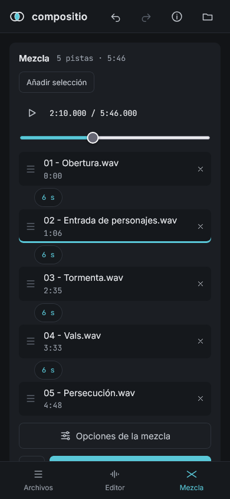
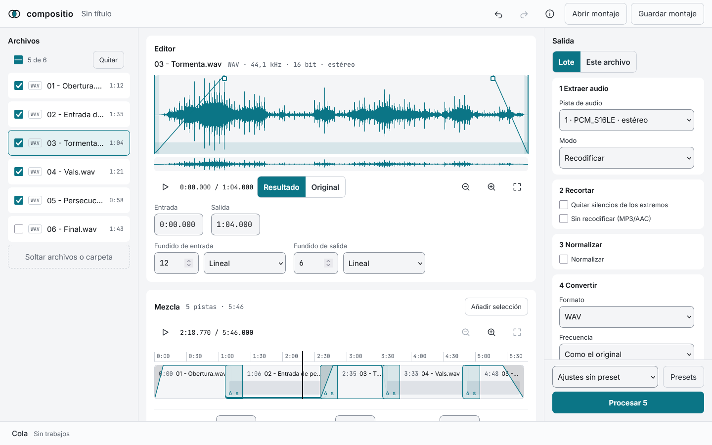

# compositio

[](https://memoriainfinita.github.io/compositio/)
[](LICENSE)

*Compositio*, Latin for putting together.

Prepare audio and video for live shows in the browser. Everything runs on your device with [ffmpeg.wasm](https://github.com/ffmpegwasm/ffmpeg.wasm); no file leaves it.

**Live:** https://memoriainfinita.github.io/compositio/

**Status:** phase 1 complete, first version not released yet. How to use it: [docs/usage.md](docs/usage.md). What each browser can do: [docs/browsers.md](docs/browsers.md).



## Files

- Drop files or a folder, subfolders included, anywhere on the page, or choose them with the system picker, the only way on phones
- Each batch is read with ffprobe and added at once, in natural order (2 before 10), as one undo step
- Checkboxes for the batch, all or none, and Remove with undo
- The editor shows the active file's format, sample rate, bit depth and channels
- Alerts for files over 2 GB, files that are not audio or video, and single-thread mode in browsers without multithreading
- A restored session lists its files as missing until they are dropped again

## Editor

- Waveform drawn part by part, playback from the file without decoding it whole
- In and out handles, fades with six curves, silences at the ends shaded
- Zoom, overview strip, keyboard shortcuts (Space, I, O, arrows)
- Result and original in real time, before processing

## Output

- Five steps in a fixed order: extract audio, trim, normalize (two-pass loudnorm, LUFS or peak), convert (WAV, FLAC, MP3, AAC/M4A, Opus, OGG), name and download
- Settings for the batch or for one file, with a mark on files that have their own
- One file downloads directly; a batch downloads file by file or as one zip
- Presets, with import and export; on the start screen, presets as quick actions that process at once
- A queue with progress, cancel and retry

## Mix

- Tracks on a strip over the timeline, reordered by dragging or with the keyboard, with their fades drawn on them
- Play the mix from the files, with a ruler, playhead and zoom
- Overlaps dragged on the strip or set to the tenth of a second; dry cuts
- Listen to about 20 s around a transition before generating the whole mix
- Fade in and out, loudness matching, WAV 24-bit or MP3 320, 44.1 or 48 kHz
- Start times as CSV

## Montages

- Save the work with a name, open it later, export and import it as a file
- A montage keeps settings only, never the audio: when reopened, files are paired by name and size

## App

- Installable where the browser offers it; files can be shared to it on Android
- «Try an example» with three sample tracks
- About, with the licences and the code of compositio, ffmpeg.wasm and FFmpeg, and a button that copies the technical details for an issue



## Limits

ffmpeg.wasm is WebAssembly in the browser:
- 2 GB per input file
- 10 to 100 times slower than native ffmpeg
- Results are downloads; originals are never overwritten

## Look

Dark and light themes that follow the system, Spanish and English, and layouts for phone, tablet and desktop. Works offline after the first visit.

## Browsers

The tests run in Firefox. Limits by browser: [docs/browsers.md](docs/browsers.md).

## Stack

Preact, Vite and TypeScript; ffmpeg.wasm with ffmpeg 5.1.4; SortableJS; client-zip. pnpm.

## Scripts

```bash
pnpm dev         # development server
pnpm test        # unit tests (vitest)
pnpm build       # production build
pnpm e2e         # end-to-end tests in Firefox (after build)
pnpm lint        # eslint
```

## Development

See [CONTRIBUTING.md](CONTRIBUTING.md).

## License

GPL-3.0-only. See [LICENSE](LICENSE). ffmpeg.wasm (`@ffmpeg/core`, `@ffmpeg/core-mt`) is GPL-2.0-or-later.

## Credits

Developed by [@memoriainfinita](https://github.com/memoriainfinita) with the assistance of Claude (Anthropic).
