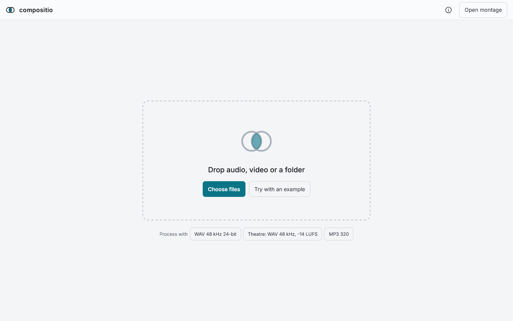
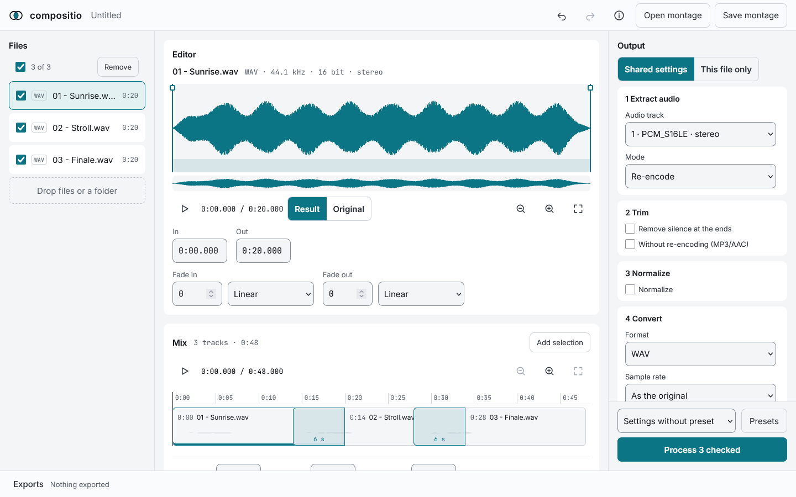
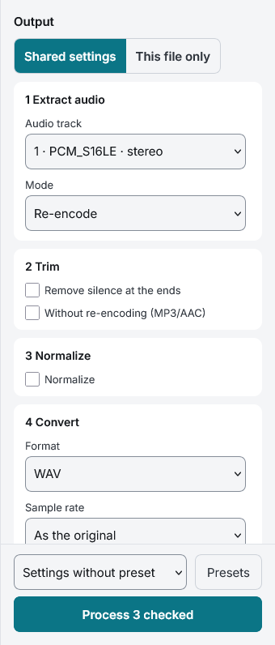
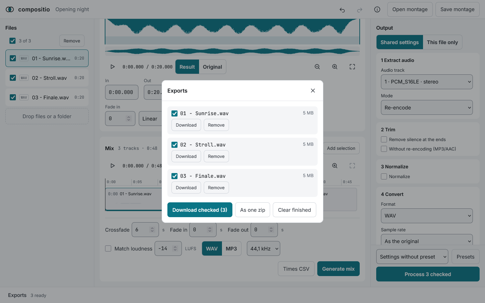

# Getting started

Open https://memoriainfinita.github.io/compositio/ in Firefox, Chrome or Safari. The first visit reloads the page once; after that it works offline.

## Add files

- Drop audio or video files, or a folder, anywhere on the page; or press «Choose files»
- «Try with an example» adds three sample tracks, handy to see everything below without files of your own
- Each file is analysed in the background: format, duration, the silence at its ends and its waveform. The file you open first has its waveform first

## The workspace

- **Files:** the checkbox marks a file for processing and for the mix; pressing the file opens it in the editor
- **Editor:** the waveform of the open file, with its in and out points, fades and the technical line (format, sample rate, bit depth, channels, and the bitrate of lossy files)
- **Mix:** the checked files one after another, with crossfades
- **Output:** the settings of what comes out, in five steps
- **Exports:** the results wait in the bar at the bottom until you download them

## Edit a file

- Drag the in and out handles, or type the times (`m:ss.mmm`)
- The handles at the top corners of the region set the fades; each fade has a curve
- Space plays and stops; I and O set in and out at the playhead; arrows move the playhead, a handle or the whole region
- Ctrl+wheel zooms, Shift+wheel scrolls; the strip under the waveform moves the view
- «Result», heard by default, plays the file as it will come out (trim, fades, normalizing); «Original» plays it as it is
- What you edit belongs to the file: it counts the same when the file is processed alone or inside the mix

## Process and download

Check the files, press «Process N checked» (with none checked, «Process this file» processes the one in the editor) and open «Exports». Nothing downloads by itself.

For more than one file at once, see [Batches](batches.md).

Undo and redo are Ctrl+Z and Ctrl+Shift+Z (or Ctrl+Y), up to 200 steps. The work in progress is saved in the browser as you go: reopening the page brings it back, with its files listed as missing until they are added again.
