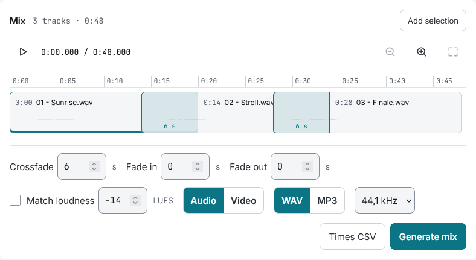
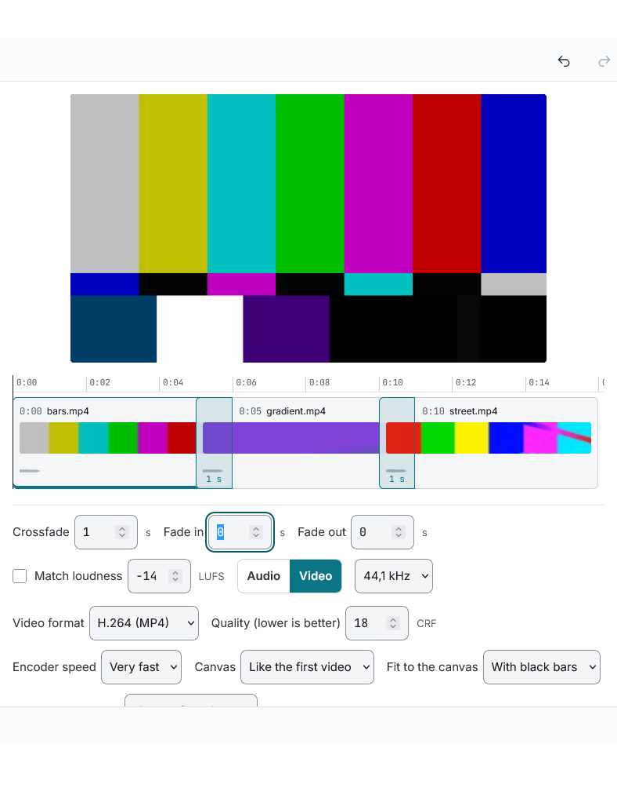

# Mixing

Put tracks one after another into one continuous mix, with crossfades, ready for a show. The mix can be of sound or of video: see [Video mix](#video-mix).

## Build it

- «Add selection» puts the checked files at the end of the mix
- On desktop, drag a file from the list to the strip and it goes in where it lands; a checked file brings all the checked ones
- Drag a track to reorder it, or press Alt+arrows on it; Delete takes it out

## Crossfades

- Drag the overlap at the start of a track to change its crossfade, or use the arrows on it
- Press the overlap to open the transition: duration, curve and dry cut. «Listen» plays about 20 s around the cross
- Each track shows its own fades and the mix's fades as ramps over it

## Listen before you generate

- «Play the mix» plays it from the files, with its fades, crossfades and loudness matching; changes are heard while it plays
- Space plays and pauses anywhere in the mix but a field
- The ruler over the strip moves the playhead: press or drag on it, or use the arrows (5 s, Shift 30 s), Home and End
- Zoom with the buttons, Ctrl and the wheel, or two fingers on the ruler
- The sample rate and MP3 are only heard in the generated mix

## Options and result

Below the strip: the default crossfade, the fade in and out of the whole mix, loudness matching with its target (-14 LUFS by default), WAV or MP3, 44.1 or 48 kHz.

- «Times CSV» saves the start of each track, for cues
- «Generate mix» makes the mix, which waits in «Exports». The WAV is 24-bit and the MP3 is 320 kbps. Without a montage name, the file is called `mezcla`
- A long mix needs memory: over 1 GiB the app warns before starting

## Video mix

«Mix result» in the options switches between Audio and Video. With Video the mix is a video file, and the clips that have a picture show it.

- **The canvas:** every clip is brought to one size and frame rate: the ones of the first video in the mix, or a fixed size. «Fit to the canvas» says how a clip of another shape enters it: with black bars, filling and cutting the excess, or stretched
- **Strip and monitor:** each clip on the strip shows its picture; a clip that is only sound is marked «Black», because that is what it will show. Above the strip, a monitor (above the list on a phone) shows the picture at the playhead and mixes the two clips of a crossfade as the generated file will. It does not show crop, fades to black or speed: the file has them
- **Crossfades:** the picture crosses with the same time and curve as the sound. A dry cut stays a cut. The fade in and out of the whole mix take the picture to black too
- **Each clip keeps** its rotation, crop and fades to black. Its size, frame rate and speed do not count in a mix: the canvas rules, and a clip with its own speed says so
- **A clip without sound** is silence for its length; a clip of only sound is black
- **Result:** `mezcla.mp4` (H.264 and AAC), or `mezcla.mov` (ProRes or HAP, with PCM sound at 24 bits). Quality, encoder speed, profile or HAP variant are set as for a file; see [Video](video.md)

A video mix takes much longer than a sound one, and it says so before it starts. WebCodecs makes it in about the length of the mix on a desktop and on the phone measured (see [Browsers](browsers.md)). If the browser has to use ffmpeg.wasm the picture crosses in a straight line whatever the curve, the app warns, and a 1080p mix may not finish on a phone. HAP needs the browser to decode every clip with a picture.
