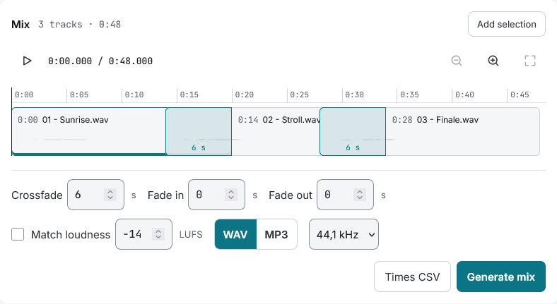

# Mixing

Put tracks one after another into one continuous mix, with crossfades, ready for a show.

## Build it

- «Add selection» puts the checked files at the end of the mix
- On desktop, drag a file from the list to the strip and it goes in where it lands; a checked file brings all the checked ones
- Drag a track to reorder it, or press Alt+arrows on it; Delete takes it out

## Crossfades

- Drag the overlap at the start of a track to change its crossfade, or use the arrows on it
- Press the overlap to open the transition: duration, curve and dry cut. «Listen» plays about 20 s around the cross
- Each track shows its own fades and the mix's fades as ramps over it

## Listen before you generate

- «Play the mix» plays it from the files, with its fades, crossfades and loudness matching; changes are heard while it plays
- Space plays and pauses anywhere in the mix but a field
- The ruler over the strip moves the playhead: press or drag on it, or use the arrows (5 s, Shift 30 s), Home and End
- Zoom with the buttons, Ctrl and the wheel, or two fingers on the ruler
- The sample rate and MP3 are only heard in the generated mix

## Options and result

Below the strip: the default crossfade, the fade in and out of the whole mix, loudness matching with its target (-14 LUFS by default), WAV or MP3, 44.1 or 48 kHz.

- «Times CSV» saves the start of each track, for cues
- «Generate mix» makes the mix, which waits in «Exports». The WAV is 24-bit and the MP3 is 320 kbps. Without a montage name, the file is called `mezcla`
- A long mix needs memory: over 1 GiB the app warns before starting
