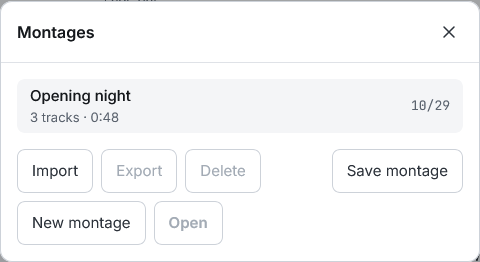

# Montages

A montage is your work saved with a name: the files by name and size, their edits, the mix and the shared settings. No audio is stored.

- «Save montage» keeps the work. If the montage already has a name it is replaced; «Save as new» keeps another one
- «Open montage» lists the saved ones. Opening one is one undo step: Ctrl+Z brings back what you had
- «New montage» starts from an empty workspace; «Delete» removes a saved one

## When files are missing

A montage opens without its audio. It lists the missing files: add them, by dropping them anywhere on the page, and they are paired by name, size and date; or open it without them. The same happens when the page reopens after a reload.

## Moving them

Montages export and import as `.compositio.json` files, to move them to another browser or device. They carry no audio: on the other device you add the files again.
