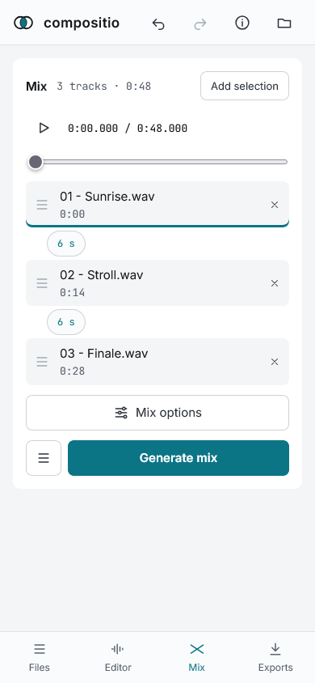

# Phone and install

## On a phone

- A bottom bar switches between Files, Editor, Mix and Exports; the output settings open as a sheet
- The system picker is the way to add files; dropping is not available
- The mix has a list of clips in place of dragging, with its options behind «Mix options», and a position slider in place of the ruler
- Several downloads always go as one zip

## Install it

The browser offers to install compositio as an app in browsers that support it; on the start page, «Install» appears when it does. Once installed it works offline, and on Android other apps can share files to it.

Safari on iOS has no install offer here and less memory for the page than a desktop browser: long mixes may not fit.

## Limits of each browser

See [Browsers](browsers.md).

## Problems

«About» › «Copy details» copies what is needed to report a problem, and «Open an issue» goes to the repository.
