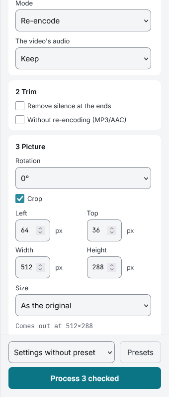
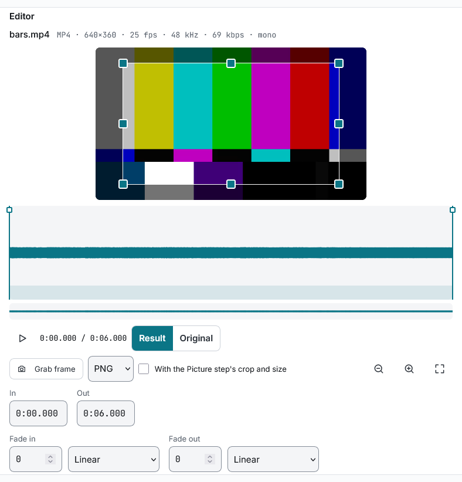

# Working with video

A video file is processed like an audio file, with one more step for the picture and a choice of what comes out.

## Open a video

Drop video files like any other. The editor shows the picture over the waveform of the sound and the technical line adds the picture's size, frame rate and codec. Playing, the in and out handles and the fades work as they do with audio; the fades also take the picture to black (see «Fades also to black» below).

## What comes out

«Tracks» has a «Result» choice for a video file:

- **Audio:** only the sound, as in [Batches](batches.md)
- **Video:** the picture too. «The video's audio» says what happens with the sound: **Keep** it, **Remove** it, **Silence** (the same length, with nothing in it) or **Replace with another file**, which is only offered in «This file only» and needs another file in the list that has audio

## The Picture step

«Picture» is between «Trim» and «Normalize», and only shows for a video.

- **Rotation:** 90, 180 or 270 degrees, on top of any rotation the file already carries
- **Crop:** drag the frame on the picture in the editor, or type Left, Top, Width and Height. The crop is applied before the size
- **Size:** *As the original*, *Fit inside* a width and height, *Fill and crop*, *With black bars* or *Stretch*, with common sizes to pick from. The step says «Comes out at W×H»; sizes go down to the nearest even number, and to a multiple of 4 for HAP, and the app says so
- **Frames per second:** the file's own or 24, 25, 30, 50 or 60 (also the 23.976, 29.97 and 59.94 of video). The output always has a constant rate
- **Speed:** from a quarter to four times. The sound follows and keeps its pitch
- **Fades also to black:** the fade in and out of the file take the picture to black as well as the sound. They are straight lines on the picture; only the sound follows the curve

Trimming a video re-encodes it, so the cut falls exactly where the handles are. «Copy without re-encoding» cuts at the nearest keyframe instead, and warns.

## Grab a frame

In the editor, «Frame» saves the picture at the playhead as a PNG or a JPEG. With «With the Picture step's crop and size» it comes out as the video would.

## Formats

«Convert» has a «Video format»:

| Format | What it is for | Sound |
|---|---|---|
| **H.264 (MP4)** | Playing almost anywhere: players, phones, the web. Quality as CRF (less is better) and encoder speed | AAC |
| **ProRes (MOV)** | Editing and playback programs that want an intermediate codec. Profile from Proxy to 4444; 4444 keeps the alpha of a source that has it. Files are large | PCM |
| **HAP (MOV)** | Media servers and VJ software, which play HAP with little work for the computer. Very large files. *Hap* is lighter; *Hap Q* keeps color and gradients better and is about twice the size | PCM |

Three presets come with a video format: «H.264 1080p 25 fps (player)», «ProRes HQ (Resolume)» and «HAP».

HAP is made by compositio itself, not by ffmpeg, and needs the browser to decode the video you give it. If it cannot, the app says so before processing; see [Browsers](browsers.md).

## How long it takes

Before processing, «Picture» says which engine will make the video and how long it expects it to take. When it will be several times the length of the video, a notice under «Process» lists the files.

- **WebCodecs** is the browser's own video codec: it is the fastest and what compositio uses whenever the browser can do the job. On a desktop, 1080p H.264 takes less than the video's length
- **ffmpeg.wasm** is the fallback, and the only way for ProRes. At 1080p it usually takes two to three times the length, and more when the video is mixed
- **HAP** takes between a fraction of the length and several times it, depending on how busy the picture is and how many processor cores the device has

To compare or to find a fault, «About» › «Video engine» can force ffmpeg.wasm or WebCodecs. HAP ignores it: it has no other way.

## Where the result goes

Results made by WebCodecs or as HAP are written to the browser's disk space as they are made, so they are not limited by memory; «Clear finished» frees them. Results made by ffmpeg.wasm are held in memory until they are downloaded.

To put several videos one after another, see [Mixing](mixing.md#video-mix).
